

  

<h1 align="center">Sorted</h1>

<b>Close the window. Keep the context.</b> 
A browser extension and web dashboard that turns a pile of open tabs into named workspaces you can reopen, share, and schedule.

  <a href="https://sorted-tab.in">Website</a> ·
  <a href="https://chromewebstore.google.com/detail/nahophdmlipeaggojkhneianeodledbe">Chrome Web Store</a> ·
  <a href="https://www.youtube.com/watch?v=SCSP6ALbSvo">Launch video</a> ·
  <a href="https://github.com/AaKaShhhhhhhhh/sorted-mobile-showcase">Sorted Mobile</a> ·
  <a href="https://github.com/AaKaShhhhhhhhh/sorted-scan-showcase">Sorted Scan</a>

  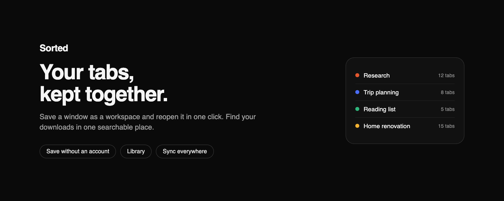

> This is a public showcase of a product I designed and built. The source code is private; this repository holds screenshots, videos, and a product overview.

---

## The problem

Every project leaves a trail of tabs: docs, tickets, references, a half-read article. Closing them feels like losing your place, so they pile up until the browser is unusable. Bookmarks don't help, because they save single links, not the *context* of what you were doing.

## What Sorted does

Sorted saves a whole browser window as a **workspace**: a named, colour-coded set of tabs you can bring back in one click, on any computer.

- **Capture in one click.** Save every open tab, or just the ones you pick, straight from the extension popup.
- **Reopen the whole context.** Open a workspace as background tabs or in a fresh window.
- **Keep sessions in sync.** While you work, Sorted notices tabs you open and close and offers to update the saved workspace.
- **Find anything.** Search across workspace names, tab titles, and web addresses.
- **Share a browsing context.** Send a snapshot link with an optional handoff note; the recipient chooses which tabs to open.
- **Bring it back later.** Set a reminder on a workspace and get nudged at the right time, including on your phone.
- **Recover mistakes.** Deleted workspaces sit in Trash for five days before they are gone.
- **Works everywhere you browse.** Chrome, Edge, and Firefox, plus a web dashboard and an Android companion app, all on one account.
- **Light and dark themes** across the extension and dashboard.

---

## Videos

<table>
  <tr>
    <td align="center" width="62%">
      <a href="media/video/sorted-product-walkthrough.mp4">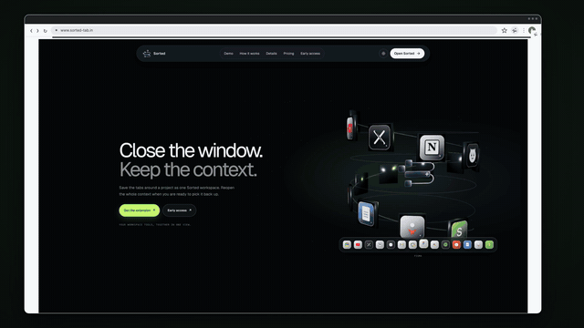</a> 
      <b>Product walkthrough</b> (60s) — <a href="media/video/sorted-product-walkthrough.mp4">watch</a>
    </td>
    <td align="center" width="38%">
      <a href="media/video/sorted-story-reel.mp4">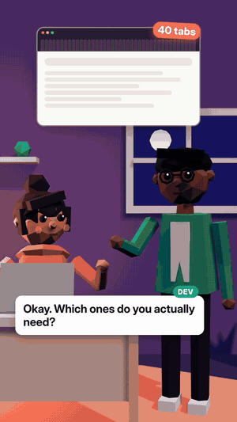</a> 
      <b>Story reel</b> (36s) — <a href="media/video/sorted-story-reel.mp4">watch</a>
    </td>
  </tr>
</table>

Full launch video on YouTube: **[youtube.com/watch?v=SCSP6ALbSvo](https://www.youtube.com/watch?v=SCSP6ALbSvo)**

---

## Web dashboard

<table>
  <tr>
    <td width="50%">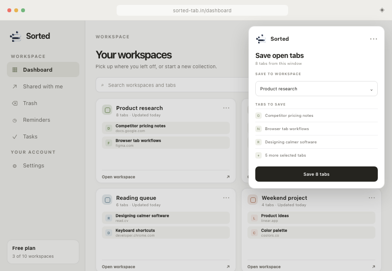 <b>Save open tabs</b> into a new or existing workspace.</td>
    <td width="50%">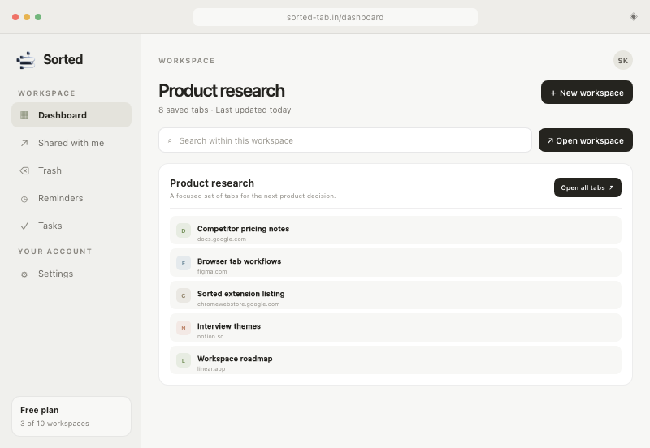 <b>Reopen a workspace</b> and every tab comes back.</td>
  </tr>
  <tr>
    <td width="50%">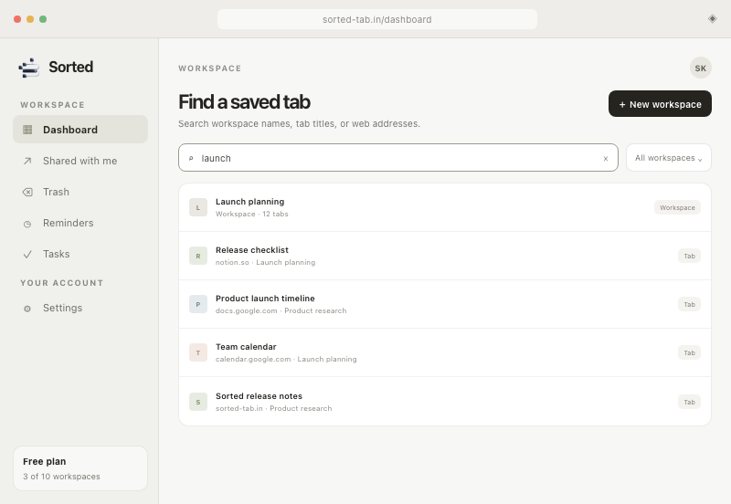 <b>Find a saved tab</b> by title, address, or workspace.</td>
    <td width="50%">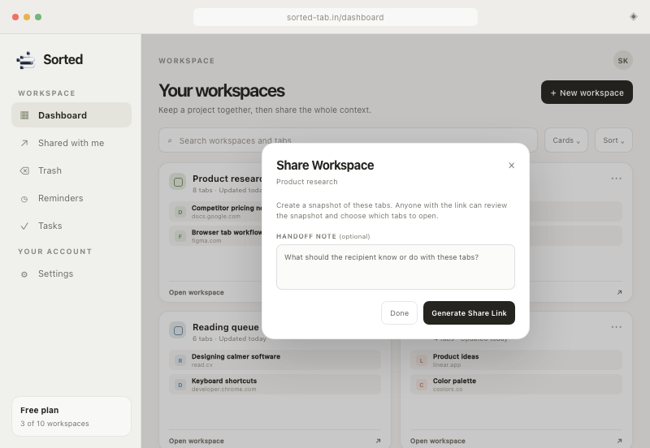 <b>Share a workspace</b> as a snapshot link with a note.</td>
  </tr>
  <tr>
    <td width="50%">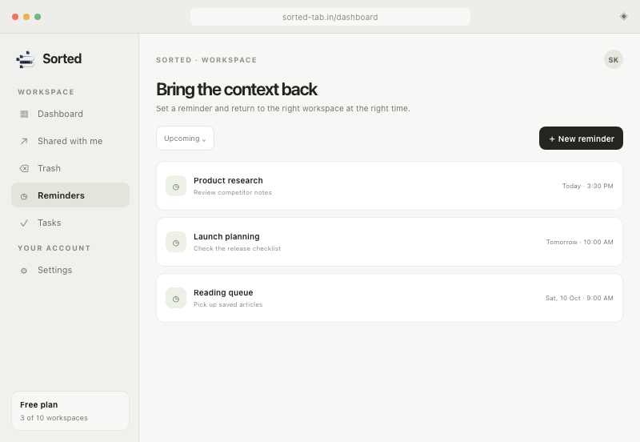 <b>Reminders</b> bring a workspace back when you need it.</td>
    <td width="50%"></td>
  </tr>
</table>

## Browser extension

<table>
  <tr>
    <td>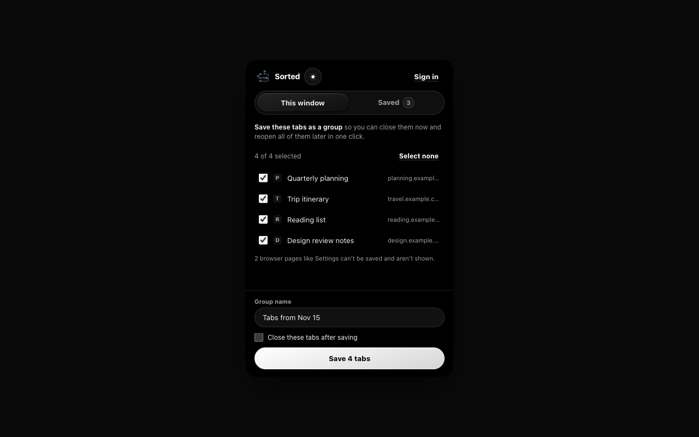</td>
    <td>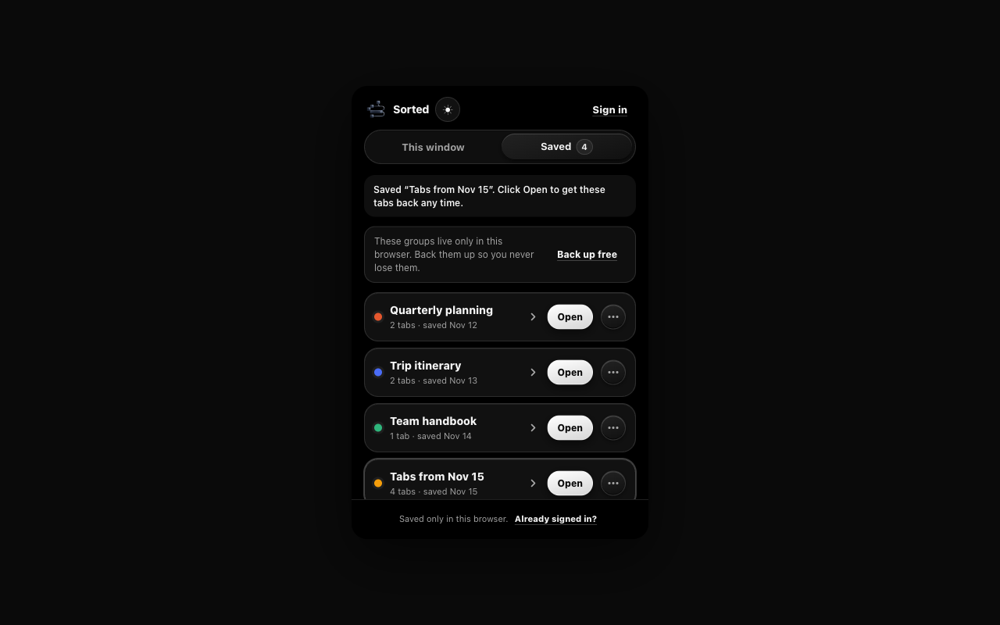</td>
    <td>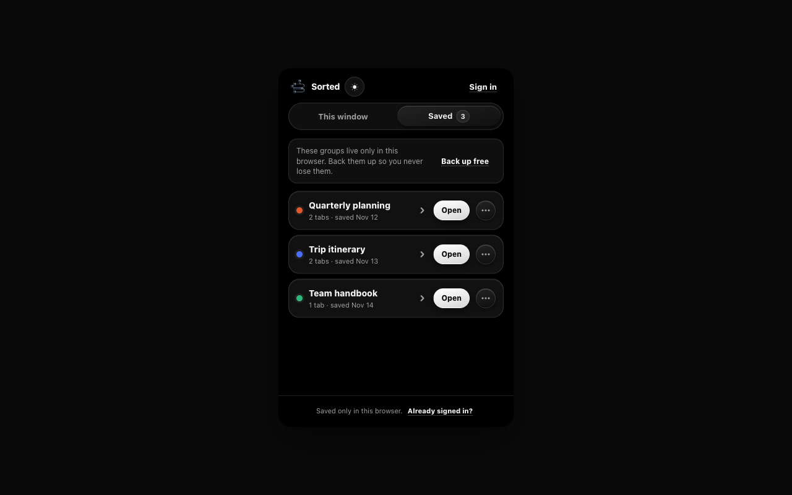</td>
  </tr>
  <tr>
    <td align="center">Pick the tabs to keep</td>
    <td align="center">Saved as a group</td>
    <td align="center">Everything saved, one click to reopen</td>
  </tr>
</table>

---

## The Sorted family

| Product | What it is |
|---|---|
| **Sorted** (this page) | Browser extension + web dashboard for tab workspaces |
| [**Sorted Mobile**](https://github.com/AaKaShhhhhhhhh/sorted-mobile-showcase) | Android companion: saved links, reminders, and planned phone time |
| [**Sorted Scan**](https://github.com/AaKaShhhhhhhhh/sorted-scan-showcase) | Android document scanner and PDF editor on the same account |

## My role

I'm a co-founder of Sorted. I also built the Sorted mobile apps: [Sorted Mobile](https://github.com/AaKaShhhhhhhhh/sorted-mobile-showcase) and [Sorted Scan](https://github.com/AaKaShhhhhhhhh/sorted-scan-showcase).

---

© Sorted. Screenshots and videos are shared for portfolio purposes. All rights reserved.

